# 🌬️ Apache Airflow Course Summary

My notes and hands-on summary from the Airflow course: what Airflow is, how its components work together, how to write DAGs (operators, XCom, branching, parallel tasks), how scheduling and incremental loading work, and how to control task dependencies and trigger DAGs.

---

## 📑 Table of Contents

1. [What is Airflow?](#1-what-is-airflow)
2. [DAGs, Tasks & Operators](#2-dags-tasks--operators)
3. [Airflow Components & Architecture](#3-airflow-components--architecture)
4. [Writing Tasks](#4-writing-tasks)
   - [Bash operator](#bash-operator)
   - [Sharing data: XCom](#sharing-data-between-tasks-xcom)
   - [Parallel tasks](#parallel-tasks)
   - [Conditional branches](#conditional-branches)
5. [Scheduling](#5-scheduling)
6. [Incremental Load & Templating](#6-incremental-load--templating)
7. [Reference: Scheduling in Depth](#7-reference-scheduling-in-depth)
8. [Reference: Task Dependencies](#8-reference-task-dependencies)
9. [Triggering DAGs](#9-triggering-dags)
10. [Quick Reference](#-quick-reference)

---

## 1. What is Airflow?

- A **task orchestration tool**: it decides *what runs, when, and in which order*.
- ❌ **Not real-time processing**: it works on schedules and intervals.
- ❌ **Not a transformation tool**: it *triggers* the tools that transform data, rather than doing the heavy lifting itself.

---

## 2. DAGs, Tasks & Operators

| Concept | Meaning |
|---|---|
| **DAG** | **Directed Acyclic Graph**: a set of tasks with dependencies and no cycles. Defined in a **Python script**. |
| **Task** | A **unit of work**. |
| **Operator** | The **type** of a task. |

**Common operators:** Bash operator · Python operator · Branch operator · SQL operator

---

## 3. Airflow Components & Architecture

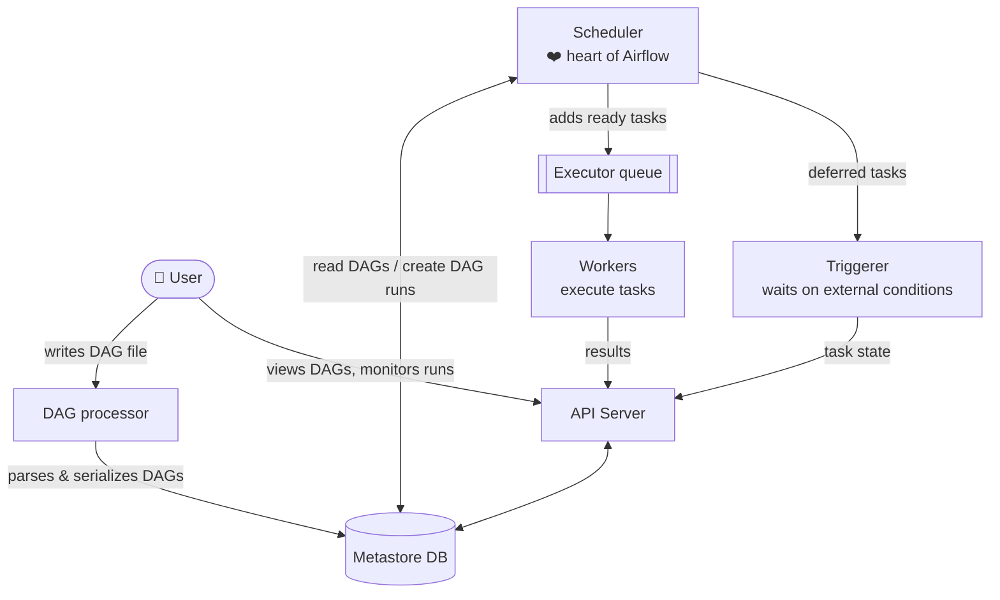

### Components

| Component | Role |
|---|---|
| **Metastore DB** | Stores data about DAGs and runs, e.g. schedule and status. |
| **DAG processor** | **Parses DAGs**, serializes them, and stores them in the metadata DB. |
| **API Server** | **Gateway** between Airflow components and the metadata DB; also the **interface** where users view the DAG graph and monitor DAG runs. |
| **Scheduler** | The **heart of Airflow** (flow below). |
| **Executor** | Defines **where** a task should run and **using what type of worker**. |
| **Queue** | Decides **which task should be performed next**. |
| **Workers** | **Execute** the tasks in the queue, do the actual work, and **send results to the DB**. |
| **Triggerer** | Checks, in the background, for **specific external conditions** (e.g. resources) to execute **deferred tasks**. |

> **Why deferred tasks?** To **free up workers** for tasks that are ready to execute, instead of letting them sit waiting.

### Scheduler loop

<p align="center">
  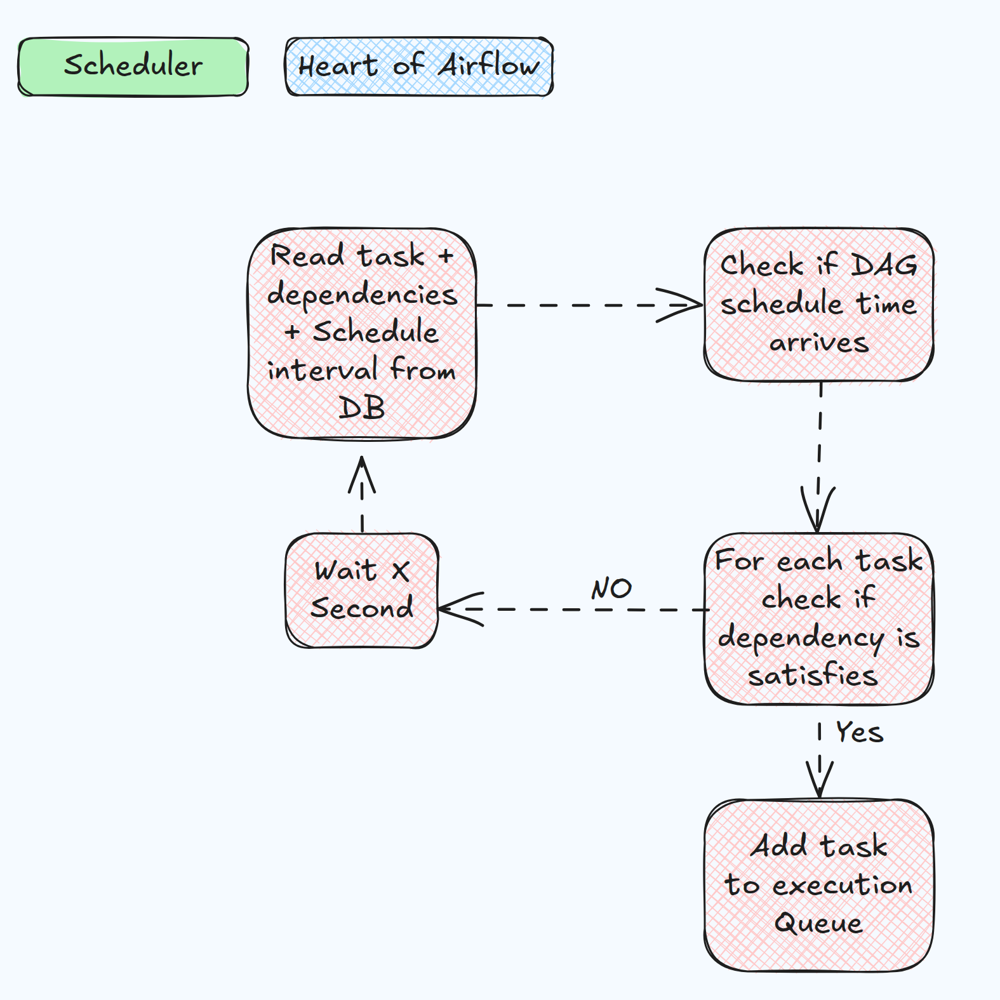
</p>

1. **Read** tasks, their dependencies and the schedule interval from the DB.
2. **Check** whether the DAG's schedule time has arrived.
3. **For each task**, check whether its dependencies are satisfied.
   - **No** → wait X seconds and try again.
   - **Yes** → **add the task to the execution queue**.

---

## 4. Writing Tasks

### Bash operator

- Runs a **bash command** from the CLI.
- The **returned string is the code** that will be executed in bash.

```python
@task.bash
def task():
    return 'echo "this is the actual bash code"'
```

### Sharing data between tasks: XCom

There are **two styles**: the **decorator style** and the **old style**.

#### Decorator-style XCom

- Lets **data travel between tasks**.
- Mainly defined in the **task dependencies** section.
- The **data returned** from one task is the **data given** to the other.

```python
@task(task_id="task_1")
def task_1():
    return data

@task(task_id="task_2")
def task_2(data):
    return 2 * data

first = task_1()
second = task_2(first)   # passing `first` as an argument creates the dependency
```

#### Old-style XCom

- Defined **inside the task functions**.
- Airflow passes the **task instance** (`ti`) in the **context**.

```python
@task
def task_1(**context):
    ti = context["ti"]
    ti.xcom_push(key="first_pushed_data", value=data)

@task
def task_2(**context):
    ti = context["ti"]
    pulled_data = ti.xcom_pull(
        task_ids="task_1",
        key="first_pushed_data",
    )
```

**Remember**

- There can be **more than one** `xcom_push` / `xcom_pull` in the same task, using **different keys**.
- The `task_ids` in `xcom_pull()` must **match the task** that did the `xcom_push()`.
- You can pull **different values from the same `task_id`** by using **different keys**.

### Parallel tasks

Defined in the **task dependency** section. The `[]` **includes the parallel tasks**.

<p align="center">
  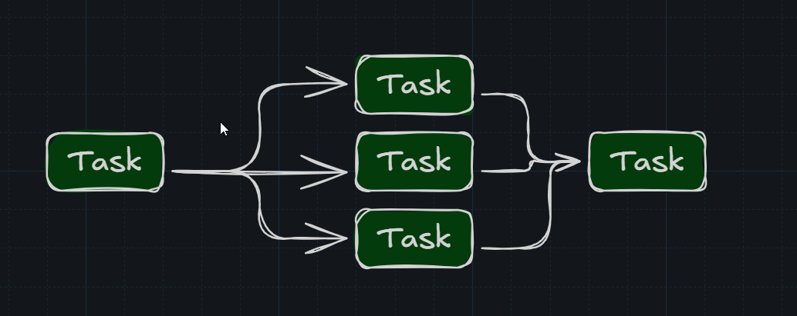
</p>

```python
first   = Extract()
second1 = transform_1(first)
second2 = transform_2(first)
second3 = transform_3(first)
third   = Load(second1, second2, second3)

first >> [second1, second2, second3] >> third
```

### Conditional branches

A **branch task** picks which downstream task(s) run, by **returning the `task_id`** to follow.

<p align="center">
  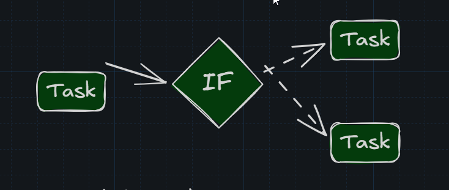
</p>

```python
@task.branch
def condition():
    if ...:
        return "task_id_1"
    else:
        return "task_id_2"

first >> second >> [task_id_1, task_id_2]   # the tasks to choose from
```

---

## 5. Scheduling

| Parameter | Required? | Notes |
|---|:---:|---|
| `start_date` | ✅ **Required** | When scheduling begins. |
| `end_date` | Optional | When scheduling stops. |
| `catchup` | Optional | `True` / `False`. Runs **all missed DAG runs** from the `start_date`. |
| `schedule` | Optional | **How often** the DAG runs (see below). |

### Schedule options

<p align="center">
  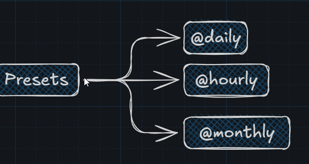
</p>

| Option | Example | Notes |
|---|---|---|
| **Presets** | `@daily`, `@hourly`, `@monthly` | Ready-made shortcuts. |
| **Cron syntax** | `CronTriggerTimetable("cron_expression", timezone=...)` | Standard cron expression. |
| **Delta** | `timedelta(days=…, hours=…, minutes=…, seconds=…)` | Run the DAG **every X amount of time**. |
| **Special schedules** | `EventsTimetable(event_dates=[...])` | Run on a **custom list of dates**. |

```python
from airflow.timetables.events import EventsTimetable

special_dates = EventsTimetable(event_dates=[...])

@dag(schedule=special_dates)
def my_dag():
    ...
```

---

## 6. Incremental Load & Templating

**Incremental load** = adding **new data to an existing table**, based on a date.

<p align="center">
  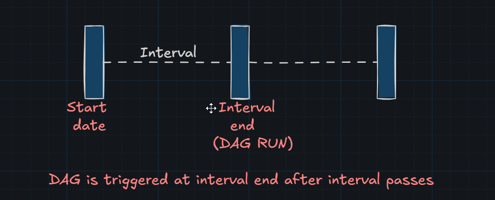
</p>

- The DAG is **triggered at the end of the interval**, *after* the interval has passed.
- Airflow gives you the interval boundaries through the **context**:
  - `data_interval_start`
  - `data_interval_end`

```python
@task
def func(**context):
    interval_start_date = context["data_interval_start"]
    interval_end_date   = context["data_interval_end"]
```

> The **DAG trigger date** is a variable you use to **construct the incremental load**.

---

## 7. Reference: Scheduling in Depth

### Cron scheduling vs. frequency scheduling

<p align="center">
  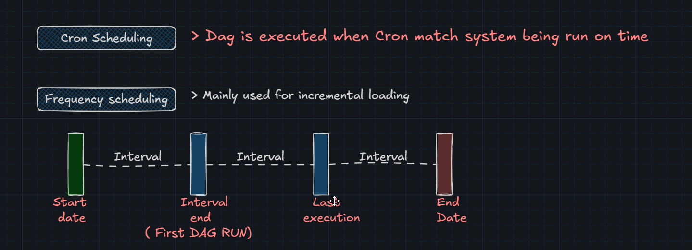
</p>

| | Behavior |
|---|---|
| **Cron scheduling** | The DAG runs when the **cron expression matches** the system's time. |
| **Frequency scheduling** | **Interval-based**; mainly used for **incremental loading**. |

> The **first execution** happens **after the first interval has passed**, counting from the start date.

### Execution context (provided by Airflow)

<p align="center">
  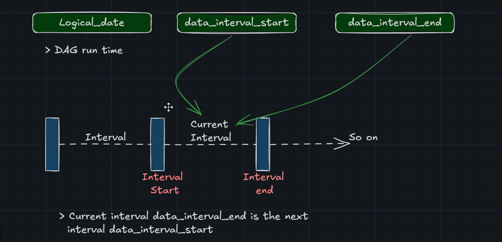
</p>

| Variable | Meaning |
|---|---|
| `logical_date` | The DAG **run time**. |
| `data_interval_start` | Start of the **current interval**. |
| `data_interval_end` | End of the **current interval**. |

> The current interval's `data_interval_end` is **the next interval's** `data_interval_start`.

### Backfilling

- **Incremental loading of historic data.**
- Done by setting **`catchup = True`** for incremental-loading DAGs.
- Past DAG runs execute **in parallel**. The maximum number running at once can be controlled in the **`airflow.cfg`** file.

### Well-behaved tasks

| Property | Meaning | Why |
|---|---|---|
| **Atomicity** | **One task = one job.** A task **completely fails or completely succeeds**. | Prevents **incomplete work**. |
| **Idempotency** | The **same input** must **not give different answers**. | Re-running a task is always safe. |

### Time-based vs. interval-based vs. asset-based scheduling

<p align="center">
  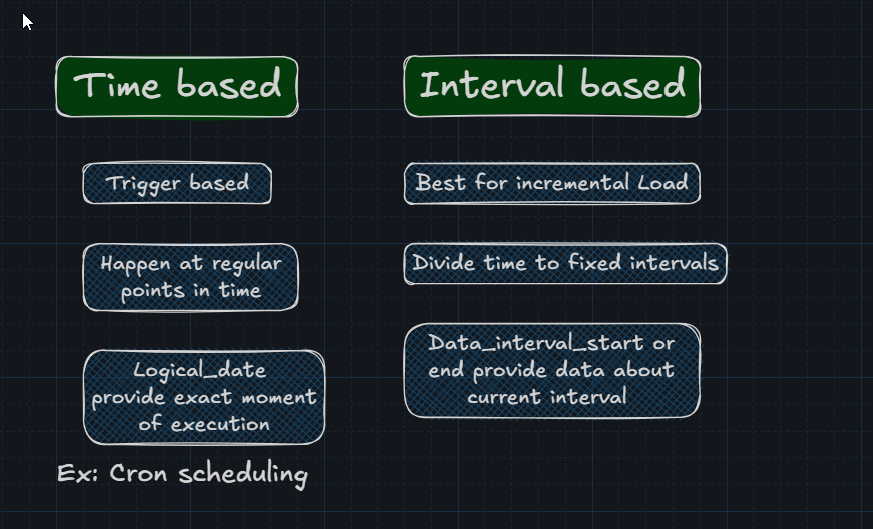
</p>

| | Time-based | Interval-based | Asset-based |
|---|---|---|---|
| **Idea** | Trigger-based: happens at **regular points in time** | **Divides time into fixed intervals** | *(left blank in my notes: fill in)* |
| **Key variable** | `logical_date` gives the **exact moment of execution** | `data_interval_start` / `data_interval_end` give data about the **current interval** | |
| **Best for** | e.g. cron scheduling | **Incremental load** | |

---

## 8. Reference: Task Dependencies

### Fan-in structure

**Multiple tasks that fan in to a single task.**

<p align="center">
  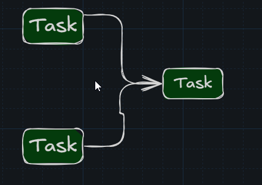
</p>

### Branching problem

<p align="center">
  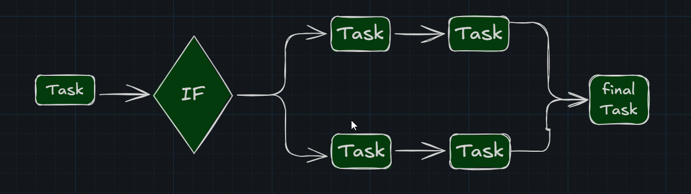
</p>

- We want **only one branch** to run.
- But there's a problem: the **final task will never run**, because it needs **both branches to succeed** to satisfy its dependencies.
- ✅ **Solution:** change the **final task's trigger rule** (see [Trigger rules](#trigger-rules)).

### Checking whether this is the latest DAG run

<p align="center">
  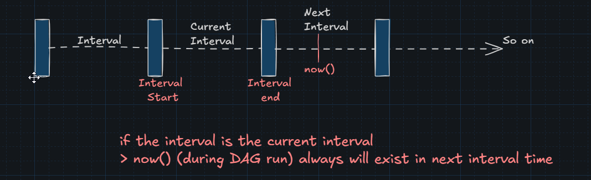
</p>

- If the run is for the **current interval**, then `now()` (during the DAG run) will **always fall inside the next interval's time**.

<p align="center">
  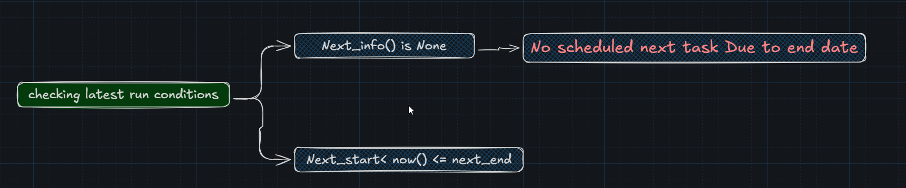
</p>

| Condition | Meaning |
|---|---|
| `next_info()` **is `None`** | **No scheduled next run**, because of the `end_date`: this is the latest run. |
| `next_start < now() <= next_end` | `now()` is inside the **next interval**: this is the current/latest interval. |

### Trigger rules

- The scheduler **constantly checks** whether a task's dependencies are satisfied.
- A **trigger rule** is the condition the scheduler checks for a task to be executed.
- The **default** is `all_success`: **all dependencies must be satisfied** for the task to run.

```python
@task(trigger_rule="none_failed")
def final_task():
    ...
```

| Rule | Behavior |
|---|---|
| `all_success` *(default)* | All upstream tasks must succeed. |
| `none_failed` | Allows upstream tasks to be **skipped** (needed after branching). |
| `all_done` | All upstream tasks must be **done**, even if some **failed**. |
| `one_success` | **At least one success** is enough. |
| `one_failed` | Runs as soon as **at least one upstream task has failed**. |

> **Propagation:** downstream tasks **fail** because one upstream task failed.

### Why doesn't the DAG run start == `data_interval_end`?

When the scheduled time arrives, the scheduler **needs some time to queue the task** and for **workers to start**. So the **DAG start time is slightly later than** the interval end.

### Sharing data between tasks (XCom, recap)

| Style | How it works |
|---|---|
| **XCom (old style)** | Cross-communication: tasks exchange data via `ti.xcom_push(key=..., value=...)` and `ti.xcom_pull(key=..., task_ids=...)`. Dependencies are defined **manually** and **only inside tasks**. |
| **Decorator style** | Data is passed as **task function arguments**. Dependencies are defined **outside the tasks**, in the task dependencies section. |

**XCom drawbacks**

- Stored values must support **serialization**.
- **Limited by the metastore DB size**: no scalability.

---

## 9. Triggering DAGs

### From another DAG

```python
from airflow.operators.trigger_dagrun import TriggerDagRunOperator

trigger_task = TriggerDagRunOperator(
    task_id="trigger_other_dag",
    trigger_dag_id="my_target_dag_id",     # the dag_id of the DAG to run
    conf={"message": "Hello World"},       # optional: pass configuration
)
```

The `conf` dictionary is passed to the DAG run, to add **custom parameters** to each run. **Reading it in the triggered DAG:**

```python
@task
def task_1(**context):
    conf = context["dag_run"].conf
    message = conf["message"]
    print(message)
```

### With the CLI

```bash
docker compose exec airflow-scheduler airflow dags trigger first_dag
```

Passing config:

```bash
docker compose exec airflow-scheduler airflow dags trigger --conf '{"message":"Hello World"}' first_dag
```

### With the REST API

**What is an HTTP request?** The message you send to an API to request something. It consists of:

| Part | Meaning |
|---|---|
| **URL** | **Where** you're sending it. |
| **Method** | **What** you want (GET, POST, …). |
| **Headers** | **Extra info** about the request. |
| **Body** | The **actual data** you're sending. |
| **Token** | Like a **password the API gives you**: you send it so the API accepts your request. |

**How to connect (using cmd):**

1. **Get the access token**

   ```bash
   curl.exe -X POST "http://localhost:8080/auth/token" -H "Content-Type: application/json" -d "{\"username\":\"airflow\",\"password\":\"airflow\"}"
   ```

2. **Trigger the DAG using your token**

   ```bash
   curl.exe -X POST "http://localhost:8080/api/v2/dags/DAG_NAME_HERE/dagRuns" -H "Content-Type: application/json" -H "Authorization: Bearer YOUR_TOKEN_HERE" -d "{\"logical_date\": null}"
   ```

---

## ⚡ Quick Reference

| Concept | One-liner |
|---|---|
| **DAG** | Python-defined graph of tasks with no cycles |
| **Scheduler** | Reads DAGs, checks schedules & dependencies, queues ready tasks |
| **Executor / Workers** | Decide where tasks run / actually run them |
| **Triggerer** | Handles deferred tasks so workers stay free |
| **`start_date` / `end_date` / `catchup`** | When scheduling starts / stops / whether to run missed intervals |
| **`data_interval_start` / `_end`** | Boundaries of the interval a run is processing (incremental loads) |
| **Backfilling** | `catchup=True` to process historic intervals in parallel |
| **XCom** | Passing data between tasks (push/pull, or via function arguments) |
| **Trigger rule** | The condition that lets a task run (`all_success` by default) |
| **Atomicity / Idempotency** | One job per task, all-or-nothing / same input → same result |
| **Trigger a DAG** | `TriggerDagRunOperator`, CLI `airflow dags trigger`, or REST API |

---

## 🗂️ Repository Structure

```
.
├── README.md
└── assets/
    ├── scheduler-flow.png
    ├── parallel-tasks.png
    ├── conditional-branch.png
    ├── schedule-presets.png
    ├── incremental-interval.png
    ├── cron-vs-frequency.png
    ├── execution-context.png
    ├── asset-vs-time-based.png
    ├── fan-in.png
    ├── branching-problem.png
    ├── latest-dag-run.png
    └── latest-run-check.png
```
